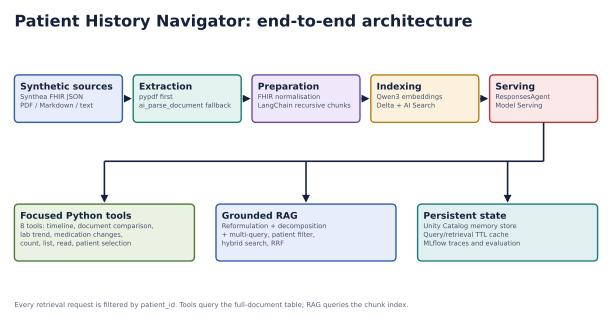
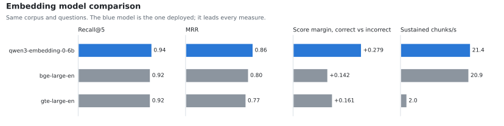
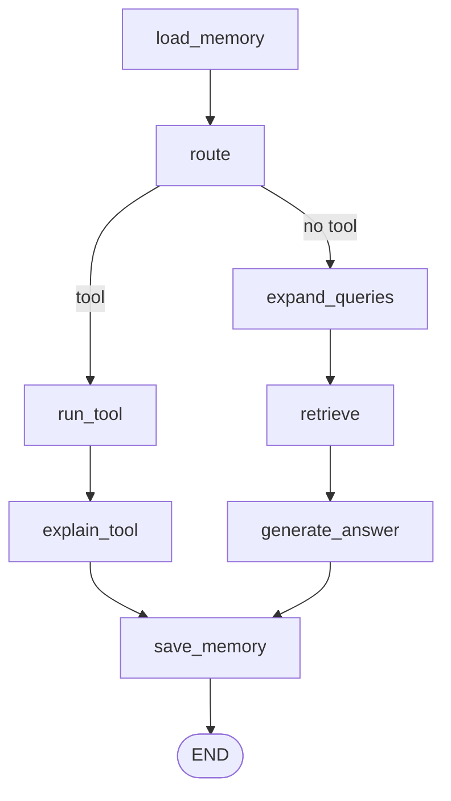

# Patient History Navigator

A domain-specific RAG system for navigating **synthetic** longitudinal patient
records, built on Databricks and tracked with MLflow. It retrieves
patient-isolated evidence with citations, and where a question is arithmetic
rather than reading — how many, what changed, what is the trend — it runs one of
eight deterministic Python functions instead of generating an answer.

It organises records. It does not diagnose, prescribe, or interpret clinical
significance.

**Team:** Alejandro Parparcen Grillet · Motunrayo Aduloju · Brayan Yesid Roncancio

<picture>
  <source media="(prefers-color-scheme: dark)" srcset="assets/architecture-dark.svg">
  
</picture>

<details>
<summary>Architecture as text</summary>

```text
Synthetic sources -> Extraction -> Preparation -> Indexing -> Serving
(Synthea FHIR,       (pypdf, then   (FHIR           (Qwen3        (ResponsesAgent
 PDF, Markdown)       ai_parse_      normalisation,  embeddings,   on Model Serving)
                      document)      chunking)       Delta + AI         |
                                                     Search)            |
                          +---------------------------------------------+
                          |                     |                       |
                 Focused Python tools     Grounded RAG          Persistent state
                 (8 deterministic tools)  (query expansion,     (UC memory store,
                                          hybrid search, RRF)    TTL cache, MLflow)
```

Every retrieval request is filtered by `patient_id`. Tools query the full-document
table; RAG queries the chunk index.
</details>

## Try it

**<https://patient-history-navigator.vercel.app>** — password-protected; ask the team for the password.

No install and no Databricks login. Pick one of five synthetic patients and ask.
The serving endpoint scales to zero after about ten minutes idle — it releases its
compute, and the next request has to start it again. That first request ("cold
start") takes roughly a minute. The **Wake it now** button on the picker screen
starts the endpoint warming while you read the roster.

## Layout

| Directory | What lives here |
| --- | --- |
| `databricks/` | The Databricks Asset Bundle: the serving agent, its support modules, the ingestion job and their configuration. Deploy from inside this directory. |
| `ui/` | The local web UI and its proxy. `python3 ui/app.py`, then open `http://127.0.0.1:8765`. |
| `vercel/` | The same UI behind the public URL above, with a password gate and credentials in encrypted environment variables. Deploy from inside this directory. See `vercel/README.md`. |
| `data-generator/` | The Synthea CCDA-to-PDF generator that produced the corpus. |
| `scripts/` | `ask.sh` for querying the deployed endpoint, two tracked MLflow experiments, seven test suites, and the builder for this README's figures. |
| `assets/` | The README's figures, light and dark, generated by `scripts/build_readme_figures.py`. |

The generated corpus under `data-generator/data/` is gitignored: it is ~700 MB and
also lives in the Volume the ingestion job reads from.

## The corpus

The generated corpus is **not** in this repository. 10,564 files live in a Unity
Catalog Volume at `/Volumes/workspace/default/rag/generated_patient_records`, which
is where the ingestion job reads them from. Those files cover **108 generated
patients as 5,172 PDFs**, plus metadata sidecars, manifests and the source CCDA XML.

Only five of those patients are ingested. What the Delta tables actually hold:

| | |
| --- | --- |
| Ingested Synthea patients | 5, selected by `file_glob: patient_7*/documents/**/*` |
| Their documents / chunks | **225 documents, 1,378 chunks** |
| Plus the seeded `demo-patient` | 8 documents, which the release evaluation set depends on |
| Table totals | **6 patient IDs, 233 documents** |

The other 103 generated patients were never parsed, embedded or indexed. The subset
stays at five because every count in the evaluation set, the UI roster and the graded
documents is tied to it. It is not a throughput limit: the embedding endpoint sustains
22 chunks/s at batch 16, which puts the full corpus at about 18 minutes.

### Choosing the embedding model

Three embedding endpoints in the workspace are 1024-dimensional, so any of them is a
drop-in swap. `scripts/compare_embedding_models.py` ran all three over the same
corpus and questions:

<picture>
  <source media="(prefers-color-scheme: dark)" srcset="assets/embeddings-dark.svg">
  
</picture>

| Model | Recall@5 | MRR | Margin | Sustained |
| --- | --- | --- | --- | --- |
| **databricks-qwen3-embedding-0-6b** (deployed) | **0.94** | **0.860** | **+0.279** | **21.4/s** at batch 16 |
| databricks-bge-large-en | 0.92 | 0.802 | +0.142 | 20.9/s at batch 16 |
| databricks-gte-large-en | 0.92 | 0.770 | +0.161 | 2.0/s at batch 8 (stalls at 16) |

Recall barely separates them. The margin, the score gap between correct and
incorrect chunks, is where the choice shows: roughly double, so the deployed model
ranks the same documents with far more confidence.

## The files in `databricks/`, and what each one does

Names describe the job the module performs, so the request path can be read off
the directory listing.

| File | Responsibility |
| --- | --- |
| `orchestration.py` | The request graph: eight nodes and the one branch between them. Topology only — node bodies are injected. |
| `serving_agent.py` | The MLflow `ResponsesAgent` that is served. Supplies the node bodies, the prompts, the clients and the trace spans. |
| `patient_tools.py` | The eight tools as LangChain `StructuredTool`s — one object per tool declaring both the schema the model sees and the function that runs. |
| `record_tools.py` | The record layer: the SQL and Python behind the eight operations. Every number in an answer is computed here. |
| `vector_retrieval.py` | Databricks AI Search: patient-filtered probes, built-in hybrid search (semantic and keyword ranks fused by the index), Reciprocal Rank Fusion across probes (RRF — merges several ranked result lists by rank rather than by score), and an ANN + full-text fallback for a workspace that refuses hybrid. |
| `query_strategies.py` | Query expansion — reformulation, decomposition, multi-query, HyDE, hypothetical questions. |
| `session_memory.py` | Persistent per-user, per-session state in a Unity Catalog managed memory store. |
| `sql_execution.py` | Statement execution against the SQL warehouse, with identifier validation and literal escaping. |
| `ttl_cache.py` | Process-local time-to-live caches for query plans and retrieval results. |
| `ingest_records.py` | The ingestion pipeline: extract, chunk, embed, index, and parse per-analyte observations. |
| `release_pipeline.py` | Build, evaluate, enforce the quality gate, register, deploy and smoke-test. |
| `seed_demo_patient.py` | Seeds the small demo record the evaluation set depends on. |
| `setup_memory_store.py` | Creates the Unity Catalog memory store. |
| `navigator_config.yaml` | Every tunable parameter: models, chunking, retrieval depth, thresholds, tables. |
| `evaluation_set.json` | The rows the quality gate scores before any model is registered. |
| `release_job.yml` | The four-task job: seed, set up memory, ingest, release. |
| `requirements.txt` | Serving dependencies, including `langgraph>=0.6,<0.7`. |

### One request

One request is a compiled LangGraph `StateGraph` — a state machine whose nodes each
read and write named keys of one shared state dict. Eight nodes:



<details>
<summary>The same graph as text</summary>

```text
load_memory
    |
  route ---- tool -------> run_tool -> explain_tool ------------+
    |                                                           |
    +--------- no tool ---> expand_queries -> retrieve ->        |
                                              generate_answer --+
                                                                |
                                                                v
                                                          save_memory
```
</details>

`route` is the only branch, and it is the model's decision: the model picks one tool
or none, and no tool means retrieval answers. Both paths converge on `save_memory`,
so every answered turn is persisted the same way.

`patient_id` is never something the model can set. In `patient_tools.py` it is
declared `Annotated[str, InjectedToolArg]`, which keeps it out of the schema the
model is shown and makes `invoke` raise if the application fails to bind it. So the
model chooses the operation; the application chooses the patient.

Three MLflow spans are emitted per request. A span is one timed step recorded inside
a trace, with its own attributes:

| Span | Type | When |
| --- | --- | --- |
| `patient_history_request` | CHAIN | Always — the root span for the request |
| `tool_selection` | LLM | Always — the model's routing call |
| `focused_patient_record_tool` | TOOL | Only when a tool answered |
| `patient_scoped_ai_search` | RETRIEVER | Only when retrieval answered |

The last two are mutually exclusive, which is why groundedness is scored per path
rather than over all evaluation rows at once.

## Running it

```bash
# deploy and release
cd databricks
databricks bundle validate
databricks bundle deploy
databricks bundle run patient_history_release

# re-release without re-ingesting (skips the ingestion task, measured at 139.6 min)
databricks bundle run patient_history_release --only release

# ask the deployed endpoint a question
cd ..
./scripts/ask.sh --list
./scripts/ask.sh 1 "how many lab records does he have?"

# the local UI
python3 ui/app.py     # then open http://127.0.0.1:8765

# publish the public copy of that UI
cd vercel
python3 sync_from_ui.py    # regenerate vercel/index.html from ui/index.html
vercel --prod
```

`ui/index.html` is the canonical page. `vercel/index.html` is generated from it by
`sync_from_ui.py`, which adds the password gate — edit the first and re-run the
script rather than keeping two copies by hand.

## Regenerating the figures

The images in this README are built from code, so the architecture labels come
from the module names and the chart from the measured numbers:

```bash
pip install matplotlib
python3 scripts/build_readme_figures.py   # writes assets/*-light.svg and *-dark.svg
```

## Checking it still works

Three suites are offline. They need no workspace, no credentials and a few seconds, so
they can run on every edit:

```bash
python3 scripts/check_tool_schemas.py  # the 8 generated tool schemas vs. a snapshot
python3 scripts/check_graph.py         # the real graph, 4 dependencies stubbed  (28 checks)
python3 scripts/check_dates.py         # normalise_date, the guard before SQL    (11 cases)
```

`check_tool_schemas.py` compares the schemas LangChain generates against
`scripts/tool_schemas_expected.json`. The schemas are derived from the tool
definitions, and every description in them steers routing, so pinning them catches a
routing change offline instead of in a live test. `check_graph.py` replaces the four
external dependencies — chat model, vector index, SQL warehouse, memory store — with
stubs and drives both paths of the real graph end to end. `check_dates.py` calls
`normalise_date` directly: it is the one function every tool date passes through on its
way into SQL, so a value it accepts wrongly becomes a query.

The rest need the deployed endpoint, and the last three also need a browser:

```bash
python3 scripts/check_tools.py        # two cases per tool, plus one single-date case  (17)
python3 scripts/check_behaviour.py    # real questions, model picks the tool    (31 cases)
python3 scripts/check_renderer.py     # markdown + escaping, in a browser       (16 cases)
python3 scripts/check_ui_queries.py   # the real page, driven in a browser      (27 questions)
python3 vercel/verify_deployment.py   # the deployed page, clicked in a browser
```

The last three need `pip install playwright && playwright install chromium`.

`check_ui_queries.py` starts `ui/app.py` on port 8791, opens the page in Chromium and
works through 27 questions one turn at a time. Per question it records which tool ran,
the answer's word count, whether a structured result slip and evidence rendered, and the
elapsed seconds. `--patient all` repeats the 27 against every roster entry, so a full
sweep is 135 questions. A recorded 24-question run returned 0 errors, median 5.9 s and
mean 127 words. It is
the suite that caught `ui/app.py` passing `http_timeout_seconds` to `WorkspaceClient`,
which the current `databricks-sdk` rejects — that broke every question on a fresh install,
and only loading the real page showed it.

Run `verify_deployment.py` after every `vercel --prod`: string checks and curl both
passed once while the deployed page was throwing on load and nothing on it could
be clicked.

## Where to read next

- `vercel/README.md` — the public deployment: its functions, environment, timing, and
  how `/api/warm` rebuilds endpoints that have been removed
- `data-generator/README.md` — how the synthetic corpus was generated
- `databricks/navigator_config.yaml` — every resource name and tuning value, with
  the measurements behind them
